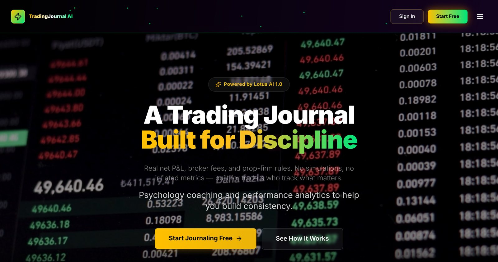
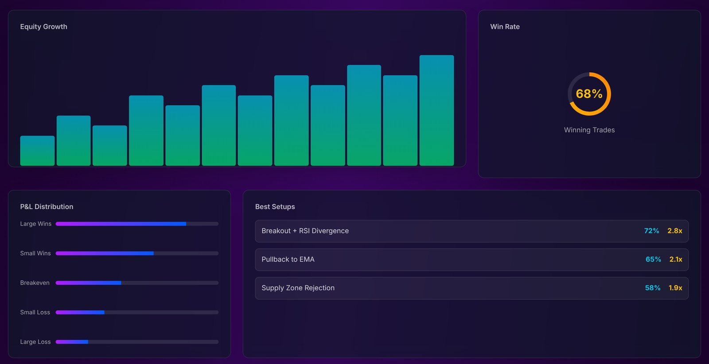
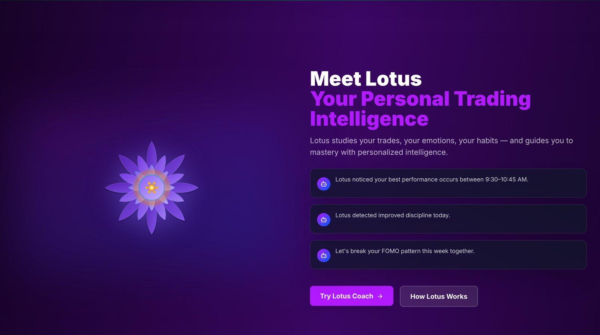

  

<h1 align="center">SmartTrade AI</h1>

  <b>A trading journal that coaches discipline, not signals.</b> 
  Log real trades, see your patterns, and get feedback from <b>Lotus AI</b>.

  

  
  
  
  
  

> **This is a showcase.** The source code is private, but the app is live: try it at the link above.

## What it does

Most trading journals stop at profit and loss. SmartTrade also tracks how each trade was taken: whether you followed your own rules, what you were feeling, and what that did to the result.

- **Journal** every trade, with risk and P&L after fees calculated for you
- **Analytics** that show what is working and what is not
- **Rules and discipline tracking**, with streaks and weekly missions
- **AI reports** with a clear improvement plan

  

## Lotus AI

Lotus is the AI coach I built for SmartTrade, using reinforcement learning. It points out repeated mistakes, emotional triggers and the moments when a trader drifts from their plan. It coaches execution and never gives trade signals.

  

## Access

Try it live at **[smarttrade-pi.vercel.app](https://smarttrade-pi.vercel.app)**. The code is private; I'm happy to give a walkthrough or share more under an NDA.
Email: **emirstsa@gmail.com**

---

Built by <a href="https://github.com/Emirsadi101470121">Emir Sadi</a> · Toronto

